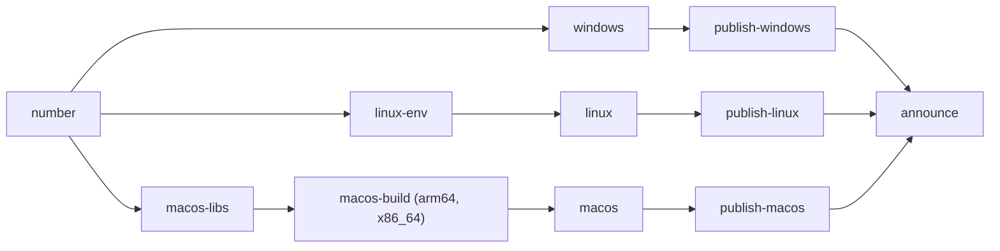

# architecture

how tele is put together: the patch queue, the tooling around it, how the fork code is organised inside the patched tree, and what ci does with it. keep this file in sync when any of it changes.

## the patch queue

tele is not a git fork of [tdesktop](https://github.com/telegramdesktop/tdesktop). this repository holds a pinned upstream tag and a queue of patches. to get the tele sources, you clone upstream at that tag and apply the queue on top.

why a queue and not a fork:

- every change is a separate, reviewable patch with a one-line subject. the queue is the changelog.
- moving to a new upstream release means replaying the queue on the new tag. a conflict points at exactly one patch, and the fix lands in that patch only.
- the diff against upstream stays visible and small. nothing drifts silently.
- ci builds from pristine upstream plus the queue, so what you review is what ships.

rules that follow from this:

- one feature per patch. later fixes and improvements to a feature are folded into its patch before a release where possible (see [folding](#folding-and-baselines)).
- fork code lives in new files. upstream files only get small hunks that call into them. small hunks survive upstream changes, big ones conflict every release.

## repository layout

```
UPSTREAM                      the tdesktop release tag the queue targets, e.g. v7.3.0
patches/tdesktop/*.patch      patches for the tdesktop repository itself
patches/<submodule>/*.patch   patches for a submodule, e.g. patches/Telegram/lib_ui/
tele.py                       applies the queue to a tdesktop checkout and exports it back
README.md                     what tele is, downloads and highlights
docs/releases.md              the patch table by release, the source of release notes
docs/features.md              the same rows by settings page, generated from releases.md
docs/*.md                     user docs (launch flags, title template, link cleaner, tele server) and these contributor docs
ci/notes.py                   github release notes and the in-app changelog json
ci/announce.py                release announcement for the telegram channel
ci/baselines.json             folded patch hashes of a previous release
ci/publish.sh                 signs one platform's update feed and adds its files to the release
ci/issue.sh                   opens, comments on and closes github issues from ci
ci/msvc.cmd                   enters the msvc environment on windows runners
ci/ccache-dated.py            compiles sources that use __DATE__ or __TIME__ again, past ccache
ci/macos-setup.sh             macos runner setup
ci/macos-libs.sh              pulls and pushes the prepared macos libraries in ghcr
ci/macos-merge.sh             joins the arm64 and x86_64 builds into one universal tele.app
ci/update-public-key.pem      public key of the update feed signature
.github/workflows/            build.yml, sync.yml, canary.yml, promote.yml
```

`.gitattributes` stores `*.patch` byte for byte (`-text`), so git never rewrites line endings inside a patch.

most patches are in `patches/tdesktop/`. submodule patches live next to them under the submodule's path, e.g. `patches/Telegram/lib_ui/`.

## tele.py

```
python tele.py [--tdesktop PATH] {checkout,continue,export,apply}
```

`--tdesktop` is a global option and goes before the command. it defaults to `../tdesktop`, next to this repository, and has to be an existing git checkout of tdesktop.

| command | what it does |
|---|---|
| `checkout [TAG] [--force]` | fetches `TAG` (default: the tag in `UPSTREAM`) from upstream, resets tdesktop to it on a branch called `tele`, syncs and updates every submodule and puts each one on its own `tele` branch, then applies the queue as commits with `git am --3way --keep-cr --keep-non-patch`. it refuses to run when any repository has uncommitted changes, an unfinished `git am` or `git rebase`, or commits that were not exported yet. `--force` discards all of that. |
| `continue` | resumes applying after you resolved a conflict and finished `git am --continue` (or `--skip`) in the reported repository. |
| `export` | turns the commits on top of the checked-out tag back into patches: `git format-patch --zero-commit --no-signature --no-numbered --full-index` for the root and every submodule with commits, into a fresh `patches/` directory. writes the checked-out tag into `UPSTREAM`. refuses with uncommitted changes, an unfinished `git am`, a group still being applied, or a commit that moves a submodule pointer. |
| `apply` | applies the queue to a fresh clone that is already on the right tag. this is what ci runs. the tag is read from `git describe --tags --exact-match HEAD`, or `UPSTREAM` when `HEAD` has no tag. |

details that matter when you work with it:

- `checkout` sets `submodule.<name>.ignore=all` in every repository, so `git status` and `git commit -a` in a parent never pick up a moved submodule pointer. commit submodule changes inside the submodule.
- re-exporting unchanged commits produces byte-identical patches: no commit hashes, no signature, no `n/m` numbering. `export` regenerates the whole `patches/` directory, so a commit inserted in the middle of the queue renumbers every patch after it.
- patch file names come from `git format-patch`: the number plus the subject, truncated. changing a subject renames the file.
- before applying, `apply` and `checkout` make sure a 3-way merge can find each patch's base blobs: every patch group whose repository isn't at the `UPSTREAM` tag (or, for a submodule, the commit the tag pins) is first replayed there in a temporary worktree. a shallow clone fetches that commit first.
- the app rename touches the same lines of `Telegram/SourceFiles/core/version.h` and `Telegram/Resources/winrc/Telegram.rc` that every release bumps. `tele.py` resolves that conflict on its own: upstream's version values, tele's name values.
- when upstream and a patch both add `#include` lines at the same spot, `tele.py` keeps both: the union of the two blocks, sorted when both were sorted. any other conflict stops the apply for a human. a file that conflicts without conflict markers (one side deleted it) is never resolved automatically.
- on a conflict it stops and prints the failing patch, the conflicted files, the `git am` output and what to run next.

state lives in `<tdesktop>/.git/tele-state.json`:

| key | meaning |
|---|---|
| `tag` | the tag the queue was applied to |
| `bases` | `HEAD` of the root and every submodule right after the checkout, before any patch |
| `pending` | patch groups that still have to be applied |
| `heads` | `HEAD` of every repository after the last apply or export, used to detect unexported work |

## patch groups

a group is a directory under `patches/`. `patches/tdesktop/` is the root repository. any other path is a submodule path inside tdesktop, like `patches/Telegram/lib_ui/`. each group is applied with `git am` inside its own repository, in file name order. a group whose path isn't a submodule of the checked-out tag is an error. a patch directly in `patches/` is an error too.

## fork code in the tdesktop tree

everything below is inside the patched tree (tdesktop after `tele.py checkout`), under `Telegram/SourceFiles/`.

### where code lives

- `tele/tele_*.cpp` and `tele/tele_*.h`: all fork code, in `namespace Tele`. one module per feature or shared piece, e.g. `tele_ghost.*`, `tele_deleted.*`, `tele_title.*`.
- bigger features have their own folders: `tele/scripting/` (the script engine, see [scripting](scripting.md)) and `tele/secret/` (secret chats). html bubbles are `tele/tele_html_*`.
- third-party code: scripts and html card scripts run on upstream's QuickJS-ng (`lib_quickjs`, from `Telegram/ThirdParty/widget-sandbox`), html bubbles on upstream's litehtml fork (`lib_litehtml`, from `Telegram/ThirdParty/twidget`). tele keeps no second copy of either: both would define the same symbols. money's wallet engine comes from [gettele/money](https://github.com/gettele/money), a copy of telegram's engine with private key import: tele's `prepare.py` hunk checks out its tag for the engine revision upstream pins.
- `settings/settings_tele.cpp` and `.h`: the tele settings section and its pages.
- `Telegram/CMakeLists.txt`: one `nice_target_sources(Telegram ${src_loc} ...)` block lists `settings/settings_tele.*` and every `tele/*` file. a new file has to be added there.
- upstream files get small hunks: an include plus a call into `Tele::`.

### build number

`Telegram/CMakeLists.txt` declares `set(TELE_BUILD 0 CACHE STRING "tele release number, 0 for local builds")` and passes it as a compile definition to `tele/tele_build.cpp` only, so changing it rebuilds one file. `Tele::BuildNumber()` returns it.

- ci builds with `-D TELE_BUILD=<N>`, the release number. the title bar shows `tele #N`, the main menu `build #N`.
- `0` is a local build: the title bar shows `tele #DEV`, the main menu `dev build`, the self-updater stays off ("local builds don't update themselves") and what's new is never fetched.

### options

every tele setting is an upstream `base::options` option. they are stored in `tdata/experimental_options.json` together with upstream's experimental options.

- `tele/tele_options.h` declares each id as `extern const char kOption...[]` plus typed getters (`bool HideStories()`), setters for string options and `rpl::producer` getters where the ui has to react live.
- `tele/tele_options.cpp` defines the ids (`"tele-hide-stories"`) and the options in an anonymous namespace: `base::options::toggle` for switches, `base::options::option<QString>` or `option<int>` for everything else, with `.id`, `.name`, `.description`, and optionally `.defaultValue` and `.restartRequired`.
- the rest of the code only calls the getters.

### settings section

`settings/settings_tele.cpp` builds settings → tele. the root page has a search field, one row per category page, and the server, backup and updates groups. after an update that adds settings, it also links to a page with just the new ones. the category pages are built by `Fill*` functions:

| page | path | builder |
|---|---|---|
| interface | `tele/interface` | `FillInterface` |
| chats | `tele/chats` | `FillChats` |
| messages | `tele/messages` | `FillMessages` |
| sending | `tele/sending` | `FillSending` |
| notifications | `tele/notifications` | `FillNotifications` |
| menus | `tele/menus` | `FillMenus` |
| privacy | `tele/privacy` | `FillPrivacy` |
| profiles and ids | `tele/profiles` | `FillProfiles` |
| bots | `tele/bots` | `FillBots` |
| debug | `tele/debug` | `FillDebug` |
| new in tele | `tele/new` | `FillNew` |

- each page is split into groups with `AddGroupTitle` and `AddGroupDivider`.
- `AddOptionToggle(builder, id, keywords, parent, children)` adds a switch for a toggle option: its name and description come from the option, and the description plus `keywords` feed the search. `parent` names the option (or `Off(id)` for an option that must be off) the row depends on: the row stays hidden until it's met. passing `children` makes the row a collapsible group: it shows how many child switches are on, its text expands or collapses the children, and its switch is a master switch that disables them without touching their values. other row types (choices, boxes, lists) have their own `Add*` helpers in the same file.
- a link or search hit for a row on another page opens the page that holds it now, and a hit inside a collapsed group expands it first.
- `tele/tele_new_settings.*` keeps the ids of every setting and page this build has in the internal `tele-known-settings` option. a build that brings ids it hasn't seen lists them on the new page until it's opened.
- every row registers a search entry, so both the tele search and the main settings search find it.
- `SetupLink` gives a row a right-click "copy link" that opens a `tg://settings/...` deep link highlighting it.

### menus

tele rearranges seven menus: the message menu, the chat ⋯ menu, the chat list row, the folder tab, the profile ⋯ menu, the send menu and the field's right-click menu.

- `tele/tele_menu_registry.*` lists every item each menu can show: a key, label, icon, the texts that identify upstream items, the contexts it appears in, and the option that gates tele items. each menu also has four layouts as text: tele's default, upstream order, minimal and power user.
- `tele/tele_menu_layout.*` holds the model (items, separators, submenus, hidden flags), its text form and the `tele-menu-layouts` option, which stores only the menus that differ from the default. keys a saved layout doesn't know go to the end of their neighbour's group.
- `tele/tele_menu_apply.*` runs once after upstream fills a menu. it identifies items (tele items are tagged when added, upstream ones matched by text), then rebuilds the menu in layout order around the same `QAction`s. rows with custom widgets and upstream submenus stay at the top level in their upstream order. alt+right-click on a menu opens its editor instead.
- `tele/tele_menu_editor.*` is the editor box: the layout as a list on the left, a live preview with a context switcher on the right.
- a tele item shows only while its feature's option is on.

### lowercase

`tele/tele_lowercase.*` has `Tele::Lower(QString)`. when the `tele-lowercase` option is on it lowercases the text, keeping lang tags and links as they are. every string tele adds to the ui goes through it. tele's own strings are hardcoded english, not `lang.strings` keys.

### launch flags

`tele/tele_launch_flags.*` parses `-noteleserver`, `-noteleupdate` and `-teleoffline` (both of the others plus third-party services) and exposes `Tele::ServerOffForLaunch()`, `Tele::UpdatesOffForLaunch()` and `Tele::OfflineForLaunch()`. every network request tele adds checks the matching flag at its lowest level: the badges fetch and crash reports check the server flag, the updater and the changelog fetch check the update flag, third-party requests like calcmula and the update checks of link-installed scripts check the offline flag. the platform launchers pass the flags on when tele restarts itself.

### tele server client

`tele/tele_badges.*` downloads the public badge list from the server in the `tele-server-url` option and applies checkmarks, custom verification, scam, fake and support marks and extra usernames. `tele/tele_crash.*` routes crash reports to the same server. the protocol is documented in [tele server](server.md). the client only downloads a list and never tells the server which accounts it looks at.

the badge json can carry a `notices` array. `tele/tele_badges.cpp` (`ParseFeed`) parses it, and `tele/tele_server_notices.*` filters notices by build, platform, user key and time, fetches photos and shows toasts. they land in the notification centre, `tele/tele_notices*.*`: a per-account encrypted history (30 days, 300 entries) behind main menu → notifications, which also logs tele toasts, rate limits, updates, sent crash and freeze reports and online alerts.

rate limits come from one hook in `mtproto/mtp_instance.cpp` (`rpcErrorOccured`) that feeds a flood-wait stream in `tele/tele_rate_limits.*`: a toast with a countdown from 5 s, a chat list bar from 60 s, and a notice when it ends.

`tele/tele_freeze_watchdog.*` runs a watchdog thread that writes a minidump when the main thread is stuck for 15 s (windows: `MiniDumpWriteDump`, linux: breakpad `WriteMinidump`, not on macos) and leaves a `tdata/freeze` marker. next launch offers it like a crash report, with a `Tele-Note: freeze N s` line.

### self-updater and the signed feed

`tele/tele_updater.*` checks `https://github.com/nitreojs/tele/releases/latest/download/tele-update-<platform>.json`, where the platform is `win64`, `linux64` or `macos`. the file is `{"feed": base64(json), "signature": base64(ed25519 signature of those bytes)}`. the inner json holds `tag`, `base` (upstream `AppVersion`), `counter` (the release number), `url`, `zip_sha256` and `exe_sha256`.

- the public key is compiled into `tele_updater.cpp` and has to match `ci/update-public-key.pem`.
- the download url has to point at this repository's releases.
- it's off for local builds, in sandboxes and while `-noteleupdate` is set. the `tele-auto-update` option turns the periodic check off.
- upstream's own updater is disabled at configure time with `DESKTOP_APP_DISABLE_AUTOUPDATE=ON`, so an official build can never replace tele.
- a release goes out one platform at a time (see [build.yml](#buildyml-build)). until a platform is published, its feed in the new release is a copy of the previous release's, which still points at the previous zip, so its clients see no update instead of a missing file.

### what's new

the release notes and the in-app "what's new" come from the same rows in `docs/releases.md`:

1. a row describes a patch: `| [N](../patches/tdesktop/NNNN-....patch) | what it does | where to toggle |`.
2. when the first platform is published, `ci/notes.py --json` writes `tele-changelog.json` with the new and changed patches, each with its text, where, url and category, and uploads it as a release asset.
3. after an update, `tele/tele_changelog.cpp` fetches `releases/download/<tag>/tele-changelog.json` for the running build and posts it once per account in a local tele chat (`tele_changelog_chat.*`, `tele_changelog_section.*`), grouped by category. fresh installs and accounts that already saw this build skip it. the `tele-show-changelog` option turns it off.

### settings export and import

`tele/tele_settings_io.cpp` exports tele settings to a file or text and imports them with a preview (`tele_settings_io_box.*`). `base::options` can't list options, so the file keeps a hand-written `Specs()` table. each entry says how an option is exported:

| helper | use |
|---|---|
| `Toggle(id)` | on/off options |
| `Choice(id, {...})` | string options with a fixed set of values |
| `Text(id, Kind::...)` | free-form strings that need their own validation |
| `People(id, Kind::..., normalize)` | per-account lists: aliases, ignored users, names, backgrounds (optional on import) |
| `Device(id, Kind::...)` | settings tied to this device, like app and tray icons (optional on import) |
| `Internal(id)` | bookkeeping that is never exported |

an option missing from the table isn't exported. export logs `Tele Settings: '<id>' is not classified for export.` for every changed `tele-` option it doesn't know.

## ci

### build.yml (Build)

runs on a push to `main` that touches `UPSTREAM`, `patches/**`, `tele.py`, `ci/**` or `build.yml`, and on manual dispatch with these inputs:

| input | meaning |
|---|---|
| `platforms` | platforms to build, default `windows linux macos` |
| `publish` | publish a release (only from `main`, and only a run that builds every platform) |
| `from_run` | publish the builds of this finished run instead of building again |
| `number` | release number to build as, empty for the next free one |



jobs:

- `number`: checks that the required repository secrets exist, picks the release number `N` (one above every existing `<UPSTREAM>-tele.*` release or tag), reads upstream's `AppVersion` from `Telegram/build/version` of the tag, and keeps them as an artifact so a later publish can reuse them. it also picks the previous release (the newest one that isn't this one) before anything is published, and decides whether the run publishes: only on `main`, for a push or `publish=true`, and only when every platform is built.
- `windows`: clones tdesktop at `UPSTREAM`, runs `tele.py apply`, prepares the libraries with upstream's `win.bat` (cached in the actions cache), configures with ninja multi-config, release only, and builds `tele.exe` with ccache. zipped as `tele-<tag>-win64.zip`.
- `linux-env` then `linux`: applies the patches, builds the docker build environment into `ghcr.io/<owner>/tele-linux-env`, keyed by the hash of the patched recipe (tele's patches change it, e.g. money's wallet engine), then builds `tele` inside it with ccache. zipped as `tele-<tag>-linux64.zip`.
- `macos-libs`, `macos-build`, then `macos`: applies the patches and prepares the universal libraries with `mac.sh`, keyed by the hash of the patched `prepare.py` and stored in ghcr by `ci/macos-libs.sh`. `macos-build` builds `tele.app` twice in parallel, once for arm64 and once for x86_64 (`CMAKE_OSX_ARCHITECTURES`), and `macos` joins them with `ci/macos-merge.sh`: every Mach-O file that differs is combined with `lipo`, everything else has to be identical, and every Mach-O file of the result has to hold both architectures. then it signs the app ad hoc and packs `tele-<tag>-macos.zip` (for the updater) and `tele-<tag>-macos.dmg`.
- every platform job configures with `DESKTOP_APP_DISABLE_AUTOUPDATE=ON`, `DESKTOP_APP_DISABLE_CRASH_REPORTS=OFF` and `TELE_BUILD=<N>`, attests its files with `actions/attest` and uploads them as artifacts kept for one day.
- `publish-windows`, `publish-linux`, `publish-macos`: one per platform, each on a fresh runner as soon as its platform is built, so the signing key never reaches a build job. `ci/publish.sh` signs the platform's update feed, verifies the signature against `ci/update-public-key.pem` and adds the platform's files to the release:
  1. the first one creates the release, titled `tele N · <upstream>`, without files and not yet marked as latest. when two finish together, the second one finds it already there.
  2. it uploads `tele-changelog.json` and, for every other platform that has no feed yet, the previous release's feed as a placeholder. these uploads never overwrite: when the file is already there, it's left alone.
  3. it uploads its own zip (and dmg and `-symbols.zip`) and its real feed, overwriting. a placeholder can never replace a real feed, and a real feed always replaces a placeholder, in whatever order the jobs run.
  4. it marks the release as latest (unless a newer one came out meanwhile) and writes a short text saying which platforms are ready, or the full notes once all three are.
- `announce`: runs once all three platforms are published. writes the full notes with `ci/notes.py`, closes the `build-failure` and `new-upstream` issues and posts the announcement with `ci/announce.py` when the announcement secrets are set.
- every job ends with `ci/notify.sh`, which sends the maintainer a private telegram message when the run starts, when each platform finishes or fails, when each platform is out, and when the release is announced or fails to. it does nothing without the `TELE_BOT_TOKEN` and `TELE_NOTIFY_CHAT` secrets.
- with `from_run`, the build jobs are skipped. `number` checks that the run succeeded, built the same `UPSTREAM`, `patches` and `tele.py` as the current commit and still has the artifacts of all three platforms, then the publish jobs publish them.
- a failed or cancelled job on `main` opens a `build-failure` issue. `announce` closes it.

caches:

- windows libraries: the actions cache, keyed by the windows sdk and the hash of `prepare.py`, saved whenever the prepared libraries changed, even when the build fails.
- windows objects: ccache (a pinned release, checked against its sha256) as the compiler launcher, in the actions cache under `win64-ccache-<run>-<attempt>`, at most 3 GB, saved on every branch when the build compiled more than 100 files, even when it fails. older ccaches of the same branch are deleted. precompiled headers need ccache's `time_macros` sloppiness, so `ci/ccache-dated.py` compiles the few sources that use `__DATE__` or `__TIME__` again after the build: a cache hit would carry the date of an older build.
- linux objects: ccache in the actions cache under `linux-ccache-<run>-<attempt>`, saved on `main` only.
- linux build environment and macos libraries: images in ghcr, not the actions cache.

### sync.yml (Sync)

every 3 hours: compares `UPSTREAM` with the latest stable tdesktop release. betas are skipped. when there is a newer one it clones it and runs `tele.py apply`.

- clean: commits `chore: bump upstream to <tag>`, pushes, starts a build with `publish=false` and opens a `new-upstream` issue with the command that publishes that run.
- conflict: opens a `patch-conflict` issue with the apply log and the steps to resolve it locally. conflicts are never resolved in ci.

### canary.yml (Canary)

daily: applies the queue to upstream's `dev` branch. a failure opens a `canary-conflict` issue, so a conflict can be fixed before the next release makes sync fail.

### promote.yml (Promote)

runs after every finished Build run. when the run succeeded and its id equals the repository variable `PROMOTE_RUN`, it dispatches build.yml on `main` with `from_run=<id>` and `publish=true`. this lets a maintainer mark a running build for release and walk away.

## release notes

`ci/notes.py` and `ci/announce.py` compare the patches of the release with those of the previous release. patches are matched by subject and compared by a hash of their changed lines only, so moved context after an upstream bump doesn't count as a change. the result is three lists: new, changed and dropped. a release on a newer tdesktop than the previous one opens with a `telegram desktop <version>` section made of upstream's own `changelog.txt` lines since the previous release's upstream.

the text of each item comes from `docs/releases.md` (or `README.md` for releases older than that file). a row has to match this exactly, on one line:

```
| [N](../patches/tdesktop/NNNN-subject.patch) | what it does | where to toggle |
```

- `N` is the patch number, the link is the patch file.
- "what it does" is one or two short lowercase sentences from the user's point of view.
- "where to toggle" says where to find it. its first part decides the changelog category:

| where | category |
|---|---|
| `tele → <page>` or `tele → <page> → <row>`, optionally followed by `, off`, `, on`, `, off, needs a restart` | the page: `interface`, `chats`, `messages`, `sending`, `notifications`, `menus`, `privacy`, `profiles and ids`, `bots`, `server`, `backup`, `updates` or `debug` |
| `always on` | `everywhere` |
| `with N` | the category of patch N, for fixes and extensions of another patch. in the app's changelog the location becomes patch N's `tele → …` path without its default, and `see N` / `(see N)` references are dropped, since patch numbers mean nothing there |
| anything else | `other` |

rows are grouped in `docs/releases.md` by the release that introduced them, newest first, under a `### [tele N](.../releases/tag/<tag>)` heading. links in a row are relative to `docs/`. a patch without a row still shows up in the notes, by its subject. `docs/features.md` holds the same rows grouped by this category, and is regenerated from `docs/releases.md` with `python ci/features.py` before a release.

## build numbering

- a release is tagged `<UPSTREAM>-tele.<N>`, e.g. `v7.2.9-tele.10`.
- `N` goes on across upstream bumps (`v7.2.9-tele.18` is followed by `v7.3.0-tele.19`). it's the `TELE_BUILD` of that release.
- the updater compares `(base, counter)`: upstream's `AppVersion` first, then `N`. so a release on a newer upstream tag is always newer.

## folding and baselines

between releases a feature can collect follow-up commits. before a release the maintainer folds them into the feature's patch where the result is the same tree, so the queue keeps one patch per feature. folding renumbers patches and changes their hashes, which would make the next release notes list old patches as dropped and new.

`ci/baselines.json` fixes that. it maps a previous release tag to `{subject: sha256 of changed lines}` of that release, folded the same way. `announce.previous_patches` (used by both scripts) prefers the baseline over the tag's own patches. a baseline is only needed for the release right after a fold.
